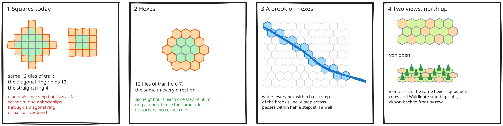
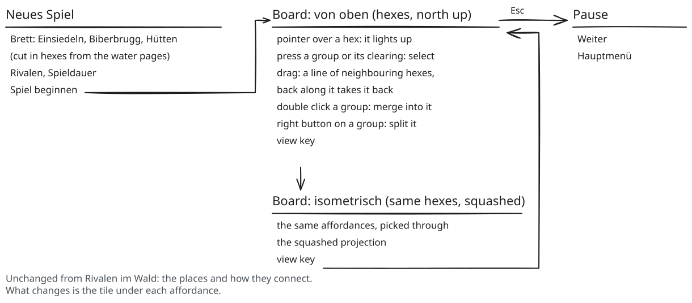

# Problem

Waldstatt Go plays on square tiles, and a Waldmensch steps to any of the eight
tiles round it. A diagonal step costs the same work as a straight one but goes
1.4 times as far, so the board is not the same in every direction:

- **Diagonals are fast.** A group crossing the board diagonally arrives in
  about seven tenths of the time, and a line of `L(size)` tiles reaches 1.4 times
  as far diagonally.
- **Diagonal rings hold more.** Rings connect diagonally, so the same trail
  closes a diamond twice the area of a square: twelve tiles of trail hold 13
  tiles as a diamond and 4 as a square. The best play is to cut diamonds, and
  the board's real shapes, the bends of the Sihl and the Alp, matter less than
  the grid's.
- **Corners need special rules.** Three rules exist only because squares meet
  at corners. Rings connect diagonally, but enclosed parts are found with
  straight steps only, so no ring leaks at a corner. A diagonal step needs land
  on both tiles beside it with no other rival's clearing, and otherwise is
  quietly made as two straight ones. A brook is rasterized half a tile wide so
  straight steps cannot slip through it. Each rule is right, but each is
  something a player meets without seeing it, and each is code the rules, the
  route finder, the computer rivals and the tests have to get right
  ([ADR 0007](../../architecture/decisions/0007-spread-each-group-over-the-tiles-of-its-waldleute.md)).

Hexagonal tiles have none of this. Every tile has six neighbours, all one step
of the same length away, and neighbours always share an edge. A ring and what
it encloses are connected by the same rule, so no ring can leak and no step can
slip through a corner. That is why many Go-like games use hexes.

The hex board succeeds when:

- a group takes the same time to cut a given distance in any direction, and a
  ring of a given trail holds about the same whatever its orientation;
- stepping, rings, enclosed parts, margins and sight all use one rule: the six
  neighbours of a tile;
- the brooks and rivers of the water pages are still unbroken walls, and a
  test proves it on every board;
- both views show the hex board, and the game plays the same in both;
- the computer rivals, retuned for hexes, still sometimes beat a first-time
  player.

# Appetite

Six weeks, including a play-test pass to retune the game and the computer
rivals on hexes. If the rules and the top-down view are not playable on hexes
after three weeks, cut the isometric view's polish (shore foam, waves and the
glints on the water) and leave the computer rivals' tuning at the switch to hex
distances, before cutting any element below.

# Solution

The square grid is replaced, not kept beside the hexes: every board is cut in
hexes and every rule uses one neighbourhood. The rules stay as they are; only
the shape of a tile changes.

The [fat-marker sketch](pitch--hex-board.fat-marker.excalidraw) shows the
problem and the shaped answer in four frames: the same trail on squares and on
hexes, a brook rasterized into hexes, and the two views.

The [breadboard](pitch--hex-board.breadboard.excalidraw) shows that the places
and how they connect do not change from Rivalen im Wald. What changes is the
tile under each affordance.

## Hex tiles in rows

Hexes stand point up and lie in rows; every other row is shifted half a tile
east. The board stays a rectangle of rows and columns with ragged sides, so it
is still stored, chunked and cut from the water pages row by row. One step to
any of a tile's six neighbours is 50 m, as a straight step is now. Rows are
then 43.3 m apart, so a board covering the same ground as today's 100 × 100
needs about 115 rows; the number of rows is a play-test value.

## One neighbourhood for every rule

The six neighbours replace both the four straight and the eight surrounding
tiles everywhere: stepping, the line a group cuts, rings and the parts they
split the board into, the margin kept between rivals, gathering and spreading
Waldleute over their clearing (ADR 0007), and sight. Distance is the number of
steps between two hexes, and it replaces both kinds of distance in use now.
The corner rule for diagonal steps and the mixed rule for rings and parts are
deleted, not carried over.

## Water from the same pages

The boards are cut from the same water pages in the same places
([ADR 0004](../../architecture/decisions/0004-compile-the-boards-from-copied-waldstatt-water-pages.md)).
A hex is lake when its centre lies inside a lake, filled even-odd as now, and
river when its centre lies within half a step of a river's line (0.6 for wide
rivers). That keeps every brook a wall: two neighbouring hexes on opposite
sides of a line are one step apart, so at least one of them lies within half a
step of it. Water labels go on the hex nearest their point.

## Drawing lines

A drawn line is a chain of neighbouring hexes that follows the pointer, and
moving back along it takes it back, as now. When the pointer jumps past a
neighbour, the line is filled with the hexes between. `L(size)` keeps its form
and is retuned.

## Two views, north up

The top-down view draws the hexes with north up. The isometric view is the same
hex board squashed to about half its height, not turned: north is up there too,
where it was upper right on the square board. Trees, Waldleute and boats stand
upright on it, drawn back to front by row. Both views pick the hex under the
pointer by inverting their projection and rounding to the nearest hex; a test
checks that every hex maps to itself and back
([ADR 0001](../../architecture/decisions/0001-move-groups-tile-by-tile-on-the-board.md)).
The ground is still painted in chunks, each pixel from the hex it lies in, so
both views draw the very same tiles. Highlights, lines, saplings, the red margin
and the flash of an enclosure follow the hexes.

## Computer rivals and tuning

The computer rivals play the same rules through the same commands, measure with
the new distance, and are retuned with the rest. The play-test pass covers the
line limit, the view radius, the rooms for being trapped and for splitting, the
board's rows and the computer rivals' thresholds, all in the existing tuning
table.

## Recorded as a decision

A new ADR records the hex board. It amends ADR 0001 (the isometric view's
45° turn), ADR 0004 (rasterizing the water pages) and ADR 0007 (the corner rule
for diagonal steps), and keeps their rationale.

# Security

Not applicable: no network, storage or new external content. The water pages
are compiled in as before.

# Rabbit Holes

- **Coordinates.** Keep `Tile` as column and row, so the board's storage, its
  chunks and the water pages' rows are unchanged, and convert to cube
  coordinates in one place for neighbours, distance, lines and rounding. Do not
  spread the parity of rows through the modules.
- **Test boards.** `Board::from_rows` keeps one character per hex. Odd rows may
  be written indented by one character so a test board reads as hexes; nothing
  else in the format changes. Rewrite the enclosure and moving tests on hexes
  rather than translating square cases one by one.
- **Proving the brooks hold.** Test every board: no step between two land hexes
  crosses a river's line. Where the half-step rule makes a brook two hexes wide
  in places, accept it; do not edit the copied water pages.
- **Rings hold less.** The same trail holds about two thirds of a diamond on
  squares, about four thirds of a square one. If rings feel too hard to close, retune
  the line limit and regrowth; do not change how rings work.
- **Pixel art on hexes.** A hex 16 pixels wide has ragged edges. Accept them, or
  raise the pixels per tile; do not anti-alias or build hex meshes. Shore depth,
  foam and waves are measured in hexes, as they are measured in tiles now.
- **Picking near edges.** Round the unprojected point to the nearest hex in
  cube coordinates; do not hit-test sprites.
- **Where the boards lie.** A board's origin stays a point on the Waldstatt's
  map, so the three boards cover the same ground; do not move or rename them.

# No-Gos

- No square boards any more, no choice between squares and hexes, and no
  abstraction over grid shapes.
- No flat-top hexes, no turning or tilting the board; north is up in both views.
- No change to the rules beyond the shape of a tile: cutting, trails, regrowth,
  enclosing, water, merging and splitting stay as they are.
- No new play mode, such as winning land; that is its own pitch.
- No new boards and no change to the copied water pages.
- No new art style: the current look, drawn on hexes.
- No multiplayer, touch input or saving.
