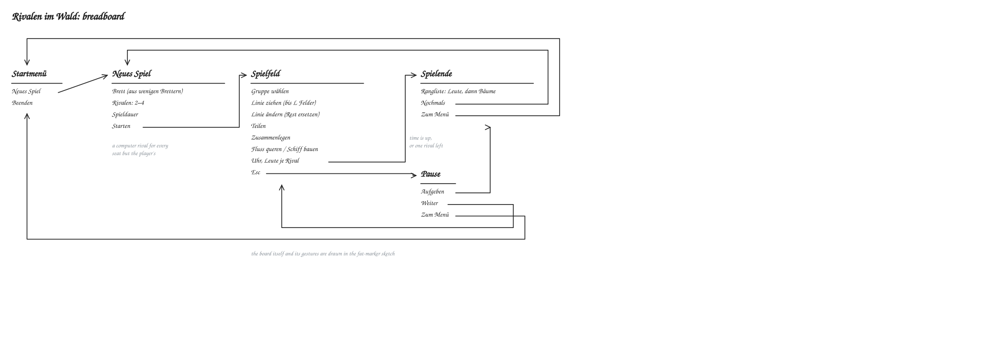
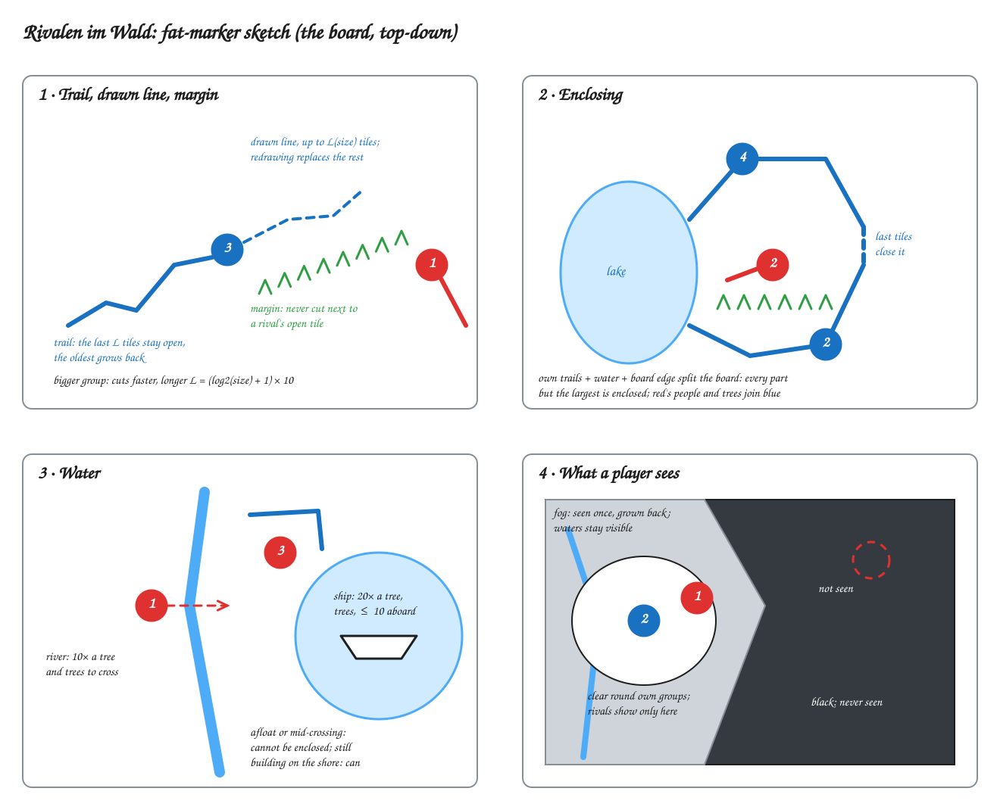

# Problem

The [Waldstatt](https://2raben.github.io/waldstatt/) (`2raben/waldstatt`) is a
building game in the forest round Einsiedeln, drawn on Switzerland's real waters.
It grew as an experiment: players fell, build, feed their Waldleute and find
texts, but nothing is at stake beyond keeping a colony alive, and the game never
asks for a decision under pressure. While shaping a goal for it, one idea stood
out from the rest: rival settlements that cut through the same forest and win
each other over by enclosing one another, as in Go.

That idea does not fit the building game. Buildings never move, so an enclosure
around them stays closed for good. Winning over a clearing with a farm and a
brewery hands over a whole economy at once, so the first capture decides the
game. And a computer rival would have to play food, mood, wear and twenty
buildings before it could play the duel. The duel needs its own game, keeping
only what makes it work: the real map, the forest, Waldleute and their axes.

This repository starts that game as Waldstatt Go. It is a new game in Rust with
Bevy, so it can run natively, which later allows multiplayer, and in the
browser. The current code is still the template's starter platformer.

The first playable succeeds when:

- a player can play a whole game against one to three computer rivals on a
  board cut from the real map, natively and in a desktop browser;
- enclosing a rival group, and being enclosed, can be seen coming and read
  afterwards: why it happened shows on the board;
- the computer rivals expand, enclose and escape well enough that a first-time
  player sometimes loses;
- the rules run headless and deterministically, so tests can play them through.

# Appetite

Six weeks for the first playable. If the rules and the board are not playable
against a simple computer rival after four, cut the browser build and the
fourth rival before cutting any rule below.

# Solution

One game on one board: rivals start scattered in an unbroken forest, cut their
way through it with groups of Waldleute, and win each other's groups by closing
rings of open ground round them. All game text is German with Swiss spelling,
like the Waldstatt's.

The [breadboard](pitch--rivalen-im-wald.breadboard.excalidraw) shows the places:
a start menu, setting up a game (board, two to four rivals, game length), the
board itself, a pause menu, and the end with the ranking. Every seat but the
player's is a computer rival.

The [fat-marker sketch](pitch--rivalen-im-wald.fat-marker.excalidraw) shows the
board's rules in four frames.

## The board

A board is a piece of the real map: tiles of 50 m, like the Waldstatt's, with
its rivers and lakes from the Waldstatt's water pages (swissTLM3D by swisstopo,
stream orders by BAFU; both are credited in the game). Every land tile starts as
forest. The first boards are about 100 × 100 tiles round Einsiedeln, where the
Sihl and the Alp run; the size is a play-test value. The board's edge is a wall,
as in Go.

## Rivals, Waldleute and groups

Each rival starts with five Waldleute, placed at random within a placing radius
round the rival's home, each alone as a group of one. The homes are spread over
the board, and nobody starts within the margin of another rival. Waldleute never
die; a rival loses them only by being enclosed. At a fixed interval every rival
still in the game gets one more Waldmensch, who joins the player's selected
group (computer rivals choose by rule).

Groups merge whenever the player sends one onto another of their own, and split
on command into two, sharing the group's trees in proportion. Splitting spreads
the risk: an enclosure takes only the part it catches.

## Cutting: lines and trails

The player selects a group and draws a line from it over the forest. The line
may be at most `L(size) = (log2(size) + 1) × 10` tiles long: ten for one
Waldmensch, twenty for two, thirty for four. The group cuts along it, one tile
after another, and earns that tile's trees. A bigger group cuts faster. Drawing
again replaces the rest of the line.

What the group has cut is its trail. The last `L(size)` tiles of a trail stay
open; the oldest grows back as a new one is cut. Regrowth is therefore not a
timer but the trail's length, and the player can see which tile closes next.
Merging trades length for speed: five groups of one hold 50 tiles of trail
between them, one group of five about 33, but it cuts much faster.

A group cannot cut a tile next to another rival's open tile, so a margin of
trees always stays between rivals, and it cannot cut through another rival's
trail. A drawn line that runs into either stops short. Only cut tiles block;
lines not yet cut are invisible to the others and block nothing.

## Enclosing

A rival's open tiles, the water and the board's edge split the board into parts.
Every part but the largest is enclosed by that rival. When a ring closes, every
other rival's group inside it changes sides at once, with its Waldleute, its
trees and its trail. Only a rival's own trails count; two rivals cannot close a
ring together. Rings connect diagonally, while groups and the test walk only
straight, so no ring leaks at a corner.

## Water

Water is a wall for enclosing, unless a group is fast enough to leave over it.
Crossing a river takes ten times as long as cutting a tile and costs trees.
Crossing a lake needs a ship: building it takes twenty times as long as cutting
a tile and costs trees, and a ship carries at most ten Waldleute. A group that is
afloat or mid-crossing cannot be enclosed; a group still building on the shore
can. A ship is used for one crossing.

## What the player sees

The board is drawn top-down. Unexplored land is black. Land seen before but
grown back is in fog, with its waters visible. Round each of the player's groups
the board is clear, and other rivals' groups and trails show only there.

## The end

A game ends when its time is up or only one rival is left. The ranking orders
the rivals by Waldleute, then by trees.

## Computer rivals

Computer rivals play through the same commands as the player and see only what
their groups see. They follow a few rules, not a search: spread out early, merge
when threatened, close rings round small visible groups, and run or take to the
water when a ring is closing round them.

## Built to be tested, and for later multiplayer

The rules run headless on Bevy's fixed timestep behind the template's `Controls`
resource ([ADR 0002](../../architecture/decisions/0002-keep-the-simulation-headless-behind-a-controls-resource.md)),
extended to commands per rival. A game starts from a seed and steps
deterministically, so tests can play scripted games through and a later
multiplayer can run the same steps on every machine. The starter platformer and
its [ADR 0001](../../architecture/decisions/0001-move-the-player-with-hand-written-kinematics.md)
are retired.

The browser build follows Car Drive's (`2raben/carrrgh`): the same crate for
`wasm32-unknown-unknown` with WebGL2, mise tasks to build and serve it, and a
GitHub Pages workflow.

# Security

No network access: the boards' water data is compiled in or shipped as assets
with the build, and games are not saved. The browser build is a static page.

# Rabbit Holes

- **The map data.** Do not port the Waldstatt's water generator, which reads
  gigabytes of swisstopo data. Copy the generated water pages a board needs into
  this repository as data, and record the Waldstatt commit they came from. The
  Sihlsee is a reservoir and only a basin in that data; leave it off the first
  boards.
- **Enclosure tests.** Split the board into parts again only for the rival whose
  open tiles changed, and only when a new tile touches that rival's trail in two
  places. At 100 × 100 tiles a flood fill is cheap; do not build an incremental
  structure.
- **Ties in the same step.** When two rivals reach the same tile, or close rings
  round each other at once, resolve it in a fixed order derived from the seed,
  never by system order.
- **A clever computer rival.** No search or planning ahead. If the rules above
  are not enough to sometimes beat a new player, tune numbers before adding
  behaviour.
- **Drawing lines.** A line is a sequence of straight steps from tile to tile,
  following the pointer. No smoothing, no path-finding round obstacles: it stops
  at the first tile it may not cut.
- **Balance.** Cutting speed by size, the interval for new Waldleute, the
  crossing costs and the board size are play-test values in one table.

# No-Gos

- No multiplayer, network or online opponents; that is the next pitch.
- No buildings, food, mood, wear, deaths or economy beyond trees.
- No saving a running game.
- No phones or touch input in this pitch; the browser build targets desktops.
- No isometric view and none of the Waldstatt's painted art; simple top-down
  tiles and markers.
- No board editor and no boards beyond the first few round Einsiedeln; no map of
  all of Switzerland.
- No sound and no scripts for groups or rivals.
- No link from the Waldstatt; that is a change in its own repository.
